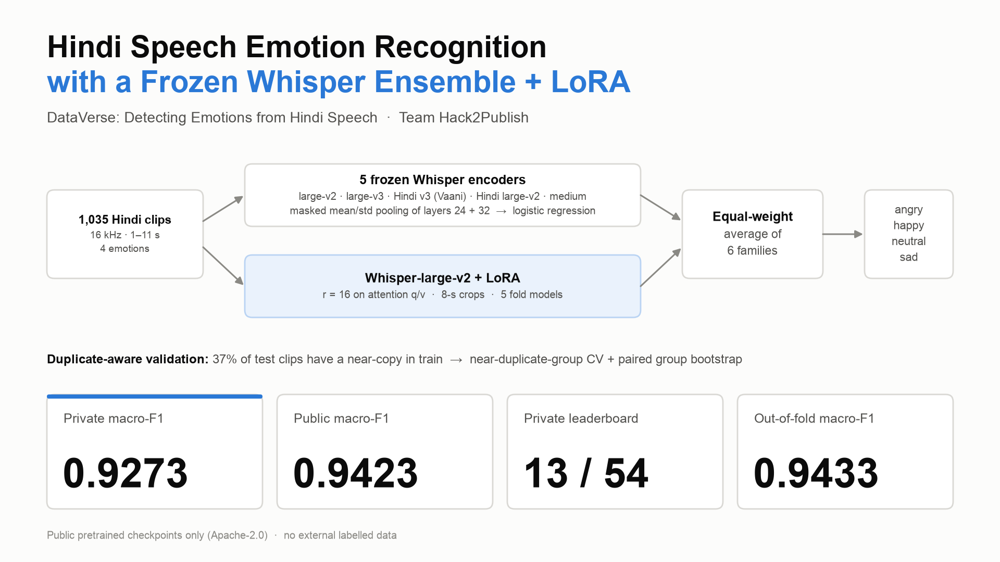

# DataVerse: Detecting Emotions from Hindi Speech — Frozen Whisper Ensemble + LoRA

Our solution to the Kaggle competition
[DataVerse: Detecting Emotions from Hindi Speech](https://www.kaggle.com/competitions/dataverse-detecting-emotions-from-hindi-speech):
4-class speech emotion recognition (angry, happy, neutral, sad), scored by macro-F1.

Team **Hack2Publish**: hosen42, foysalemonshanto.



## Results

| Submission | Public | Private |
|---|---|---|
| **B8: LoRA Whisper-large-v2 + 5 frozen Whisper families** (final) | **0.94230** | **0.92730** |
| B6: 5 frozen Whisper families + public WavLM fine-tune ensemble | 0.93060 | 0.92691 |
| Public WavLM baseline (reference) | 0.87918 | 0.84003 |

The final submission placed **13th of 54 teams** on the private leaderboard.

## Approach

* **Five frozen Whisper encoders**, each followed by a logistic-regression head:
  * `openai/whisper-large-v2`, `openai/whisper-large-v3`, `ARTPARK-IISc/whisper-large-v3-vaani-hindi`,
    `vasista22/whisper-hindi-large-v2` and `openai/whisper-medium`.
  * Per-layer mean and standard deviation are pooled **only over the frames that cover real audio**.
  * Large models use layers 24 and 32; medium uses layers 22–24.
  * Each head is `StandardScaler` + `LogisticRegression(C=0.05, class_weight="balanced")`.
* **One fine-tuned family:** the Whisper-large-v2 encoder with LoRA (r = 16 on attention q/v), trained on 8-s crops for
  6 epochs; the 5 fold models are averaged.
* **Ensemble:** an equal-weight average of the six families' probabilities, plus a near-duplicate safety net that uses
  training labels only.
* **Validation that respects near-duplicates:**
  * 37% of the test clips have a waveform near-copy in the training set.
  * Models are therefore compared on duplicate-group-disjoint folds and with a paired bootstrap over duplicate groups.

The full write-up is in [`research/KAGGLE_WRITEUP_CONTENT.md`](research/KAGGLE_WRITEUP_CONTENT.md). The final experiment
report, including negative results, is [`research/B9_experiment_report.md`](research/B9_experiment_report.md).

## Repository layout

| Path | Contents |
|---|---|
| `notebooks/B9_hindi_ser_final.ipynb` | **Complete train + inference pipeline.** Kaggle/local path detection, smoke and full modes, pinned model revisions, cached stages, submission assertions. Its default reproduces B8. |
| `notebooks/B8_whisper_lora_blend.ipynb`, `notebooks/B6_whisper_blend.ipynb` | The notebooks behind the B8 and B6 submissions. |
| `research/scripts/` | The final pipeline's code: data audit, near-duplicate grouping, frozen-feature extraction, family blending, LoRA / LP-FT training, evaluation (CV, paired bootstrap, diagnostics, parity checks) and the notebook builders. |
| `research/B9_experiment_report.md`, `research/B9_ledger.csv`, `research/experiments.csv` | Final experiment report and ledgers with measured results. |
| `research/KAGGLE_WRITEUP_CONTENT.md`, `research/writeup_media/` | Competition write-up and its images. |

## Data

**The competition data is not included, and nothing derived from it is either:** no labels, transcripts, features,
probabilities or submission files. The competition rules forbid redistributing the data.

To get it, join the competition on Kaggle, then run:

```bash
kaggle competitions download -c dataverse-detecting-emotions-from-hindi-speech -p data && unzip data/*.zip -d data
```

The notebook expects `data/SRCASW-BhavVaani/{train.csv,test.csv,sample_submission.csv,train/,test/}` locally, or the
competition input on Kaggle. Many scripts in `research/scripts/` read intermediate artifacts from `research/work/`. These
are produced locally by the pipeline and are not published.

## Running

**On Kaggle**
1. Import `notebooks/B9_hindi_ser_final.ipynb`.
2. Add the competition as input.
3. Enable a GPU, and turn **Internet** on so the Whisper checkpoints can download.
4. Choose *Run All*.

To smoke-test first, add a cell at the top with `import os; os.environ["B9_MODE"] = "smoke"`. A smoke run writes
`submission_smoke.csv`, which must never be submitted.

**Locally**
* Put the data in `data/`.
* Use Python ≥ 3.10 with `torch`, `transformers` (tested with 4.57 and 5.19), `peft`, `scikit-learn`, `soundfile` and
  `scipy`.
* Run the notebook from `notebooks/`.

## License

* The code and documents are released under the **Apache License 2.0** (see [`LICENSE`](LICENSE)).
  Copyright 2026 Team Hack2Publish.
* The pretrained Whisper checkpoints we use are Apache-2.0 models from the Hugging Face Hub.
* The competition data belongs to its owners and is governed by the competition rules.

## Acknowledgements

Thanks to the competition hosts for the dataset, and to the authors of the public WavLM baseline notebooks.
